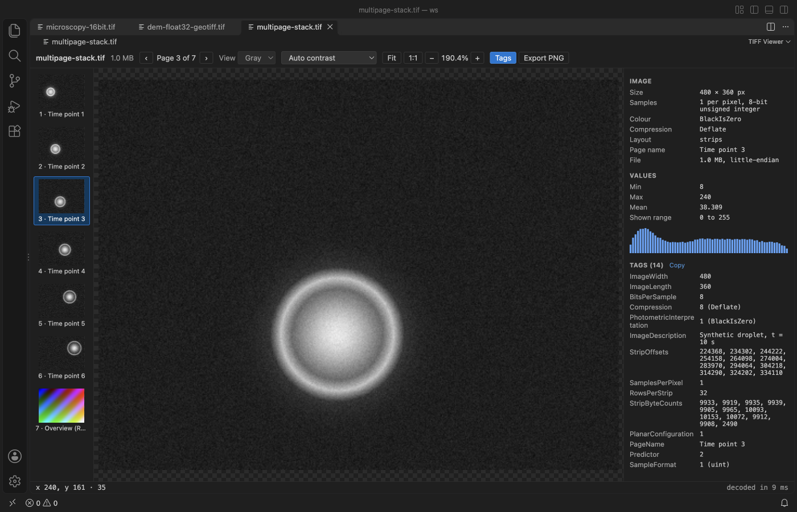
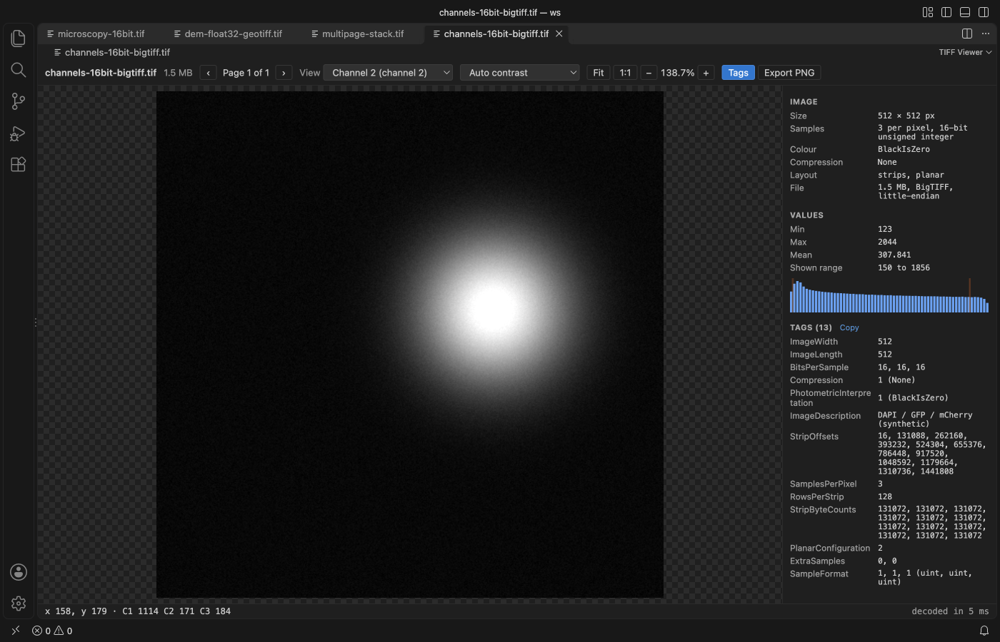
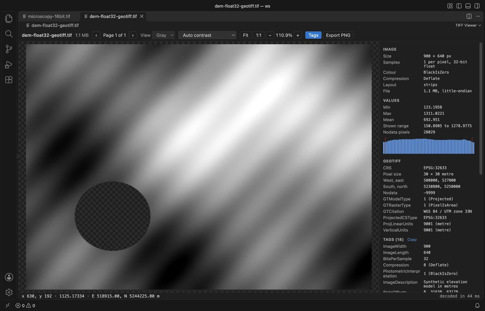

# TIFF Viewer & TIF Viewer (16-bit, GeoTIFF)

Click a `.tif` or `.tiff` file and see it in VS Code, even when it is a 16-bit microscope image, a float32 elevation model or a 200-page stack.

*Real output from VS Code 1.142 on macOS. The file is `microscopy-16bit.tif`, made by `scripts/make-samples.js`. `scripts/e2e-vscode.mjs` installed the packaged extension in a clean VS Code profile, opened the file, moved the pointer over a cell and saved the window through the debug port.*

- You see the data, not a black square. 16-bit, 32-bit and float pages open with a percentile stretch, and you can switch to min to max, 2 to 98 percent or the full type range. The status bar shows the stored value under the pointer, not the display colour.
- GeoTIFF tags are readable. The panel shows the EPSG code, pixel size, bounds and nodata value, and the status bar gives the map coordinate of the pixel you point at. Nodata and NaN pixels stay transparent and are left out of the statistics.
- Big files don't block the editor. Pixels are decoded in a background worker. Files over 1 GB show a clear message and still list the tags of every page, read with a few small reads from disk.

## Quick start

1. Install TIFF Viewer.
2. Click any `.tif` or `.tiff` file in the Explorer. Scroll to zoom, drag to pan, and move the pointer to read values.

If another viewer opens, right-click the file and pick "Open in TIFF Viewer", or use "Reopen Editor With..." from the editor title menu. "TIFF Viewer: Get Started" in the Command Palette opens a short tour.

## What it reads

| | Supported |
|---|---|
| Containers | Classic TIFF and BigTIFF, little and big-endian, strips and tiles, chunky and planar |
| Sample types | 1, 2, 4, 8, 16, 32 and 64-bit unsigned and signed integers, 16, 32 and 64-bit float |
| Colour | Gray (BlackIsZero and WhiteIsZero), RGB and RGBA, palette, CMYK, YCbCr in JPEG |
| Compression | None, LZW, Deflate, PackBits, JPEG, CCITT Group 3 and 4 |
| Predictors | Horizontal (2) for every integer size, floating point (3) |
| Pages | Every page in the file, with thumbnails for the first 300 |

ZSTD, LERC, WebP and JPEG 2000 compressed pages are listed with their tags and a note that they can't be decoded.

## Pages, channels and contrast

Multi-page files get a page strip with thumbnails and page names. PageUp and PageDown (or J and K) move through the pages.

The View menu offers the RGB composite and each channel on its own. Files with three or more gray channels, such as fluorescence stacks stored as planar samples, can be shown as RGB or one channel at a time.

The Values section lists min, max, mean, the range on screen, nodata and NaN counts, and a small histogram with the range marked. 8-bit images open as stored. Everything else opens with the 0.5 to 99.5 percentile stretch.

## GeoTIFF

When a page has ModelPixelScale, ModelTiepoint, ModelTransformation or GeoKeyDirectory tags, the panel adds a GeoTIFF section with the CRS, pixel size, units, bounds, GDAL nodata value and each GeoKey by name. The pointer readout adds easting and northing, or longitude and latitude for geographic rasters. Map tiles and reprojection are not part of this extension, so it works with no network.

## Zoom, export and keys

| Action | How |
|---|---|
| Zoom | Mouse wheel or pinch, the + and - buttons, or the + and - keys |
| Fit and actual pixels | Fit and 1:1 buttons, keys 0 and 1, or double click |
| Pan | Drag the image |
| Next and previous page | PageDown and PageUp, J and K, or the page strip |
| Tags panel | Tags button or T |
| Export | Export PNG saves the page as shown, with the channel and stretch you picked |
| Copy tags | Copy, next to the Tags heading, puts every tag on the clipboard as tab-separated text |

## Settings

| Setting | Default | What it does |
|---|---|---|
| `tiffViewer.maxFileMB` | 1024 | Files up to this size are decoded. Larger files show a message and the tags of every page. |
| `tiffViewer.askForRating` | true | Ask one time for a Marketplace rating after a few days of use. Nothing is sent anywhere. |
| `tiffViewer.showSupportLinks` | true | Show the small Sponsor and More free viewers links in the status line. |

## Privacy and safety

The extension makes no network calls and has no telemetry. The viewer is read-only. The TIFF file is never written, and the only file the extension writes is the PNG you save with Export PNG. The webview runs under a strict Content Security Policy, and tag text is shown as plain text.

## Limits

- Pages over 6000 pixels on a side, or over 24 million pixels, are shown with every Nth pixel. The Values section says when this happens, and the pointer readout still reads full resolution values. Statistics use every pixel.
- A file is held in memory while it is open, so the default limit is 1 GB. In our test an 8000 by 6000 16-bit page decoded, got its statistics and was drawn in about 0.6 s (Node on an Apple Silicon Mac).
- Tiled pages with fewer than 8 bits per pixel, uncompressed YCbCr and the compressions named above are not decoded.
- Sub-images stored in SubIFDs, such as some DNG and OME-TIFF pyramids, are listed in the tags but not shown as pages.

## Support Zovo

Zovo extensions are free, with no ads and no tracking. They are made by [theluckystrike](https://github.com/theluckystrike) on GitHub. If this one saves you time, you can support the work:

- [Sponsor on GitHub](https://github.com/sponsors/theluckystrike)
- [Follow theluckystrike on GitHub](https://github.com/theluckystrike)

## More tools by Zovo

- [HDF5 & NetCDF Explorer (H5 Viewer)](https://marketplace.visualstudio.com/items?itemName=zovo.hdf5-netcdf-explorer) browses groups, attributes and values in HDF5 and NetCDF files and plots slices.
- [GGUF, Safetensors & NPY Viewer (NumPy Viewer)](https://marketplace.visualstudio.com/items?itemName=zovo.tensor-viewer) shows NPY, NPZ, Safetensors and GGUF tensors with stats and heatmaps.
- [DICOM Viewer & NIfTI Viewer for CT and MRI](https://github.com/theluckystrike/dicom-nifti-viewer-vscode) opens CT and MRI scans, DICOM folders and NIfTI volumes with window presets and three views.

See [all Zovo extensions on the Marketplace](https://marketplace.visualstudio.com/publishers/zovo).

## License

MIT. The decoder uses [UTIF.js](https://github.com/photopea/UTIF.js) (MIT) and [pako](https://github.com/nodeca/pako) (MIT). See THIRD-PARTY-NOTICES.md.
